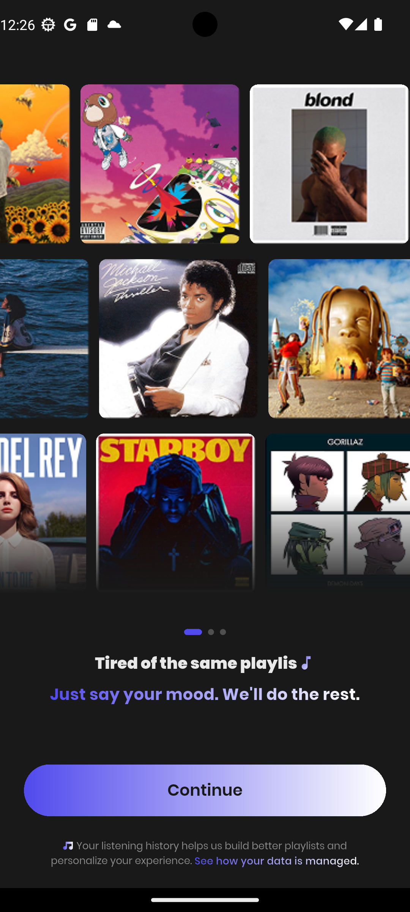
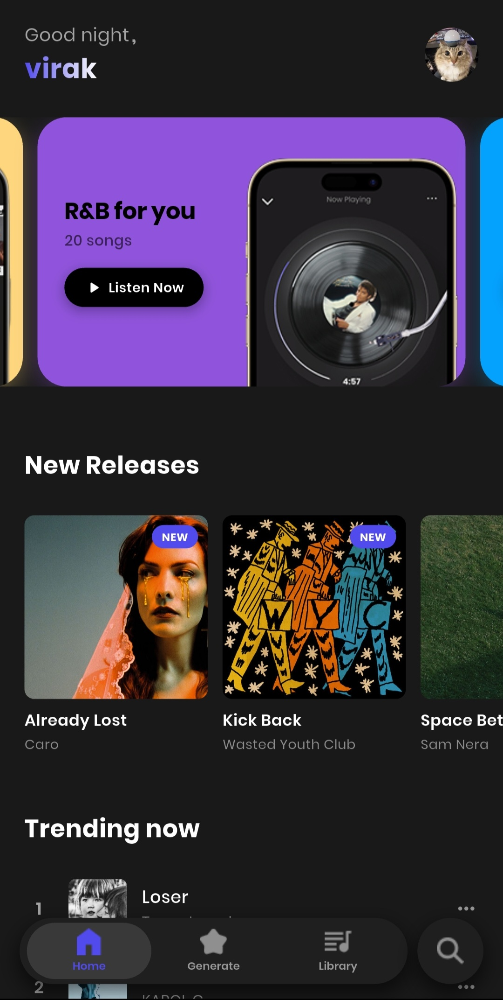
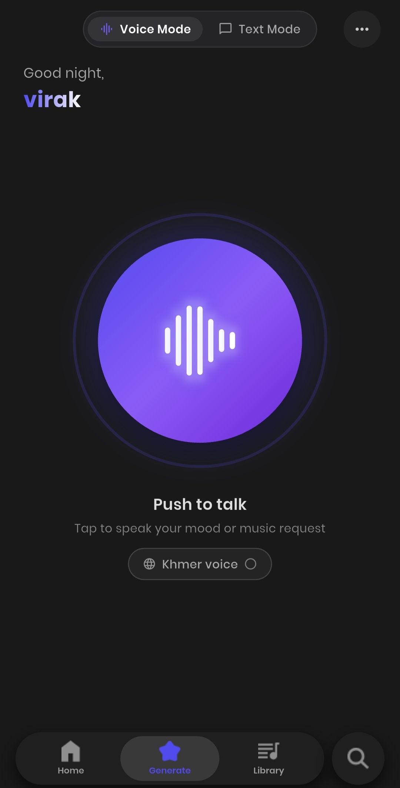
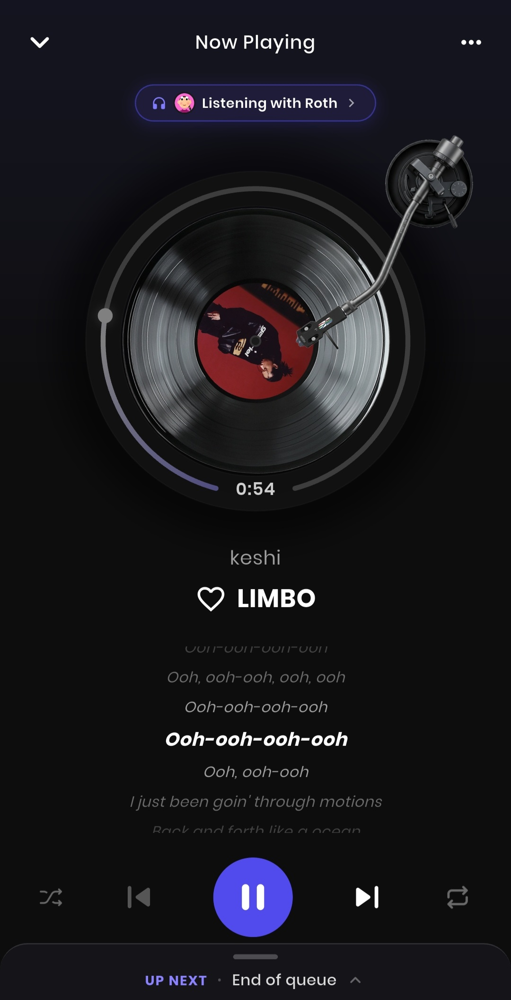
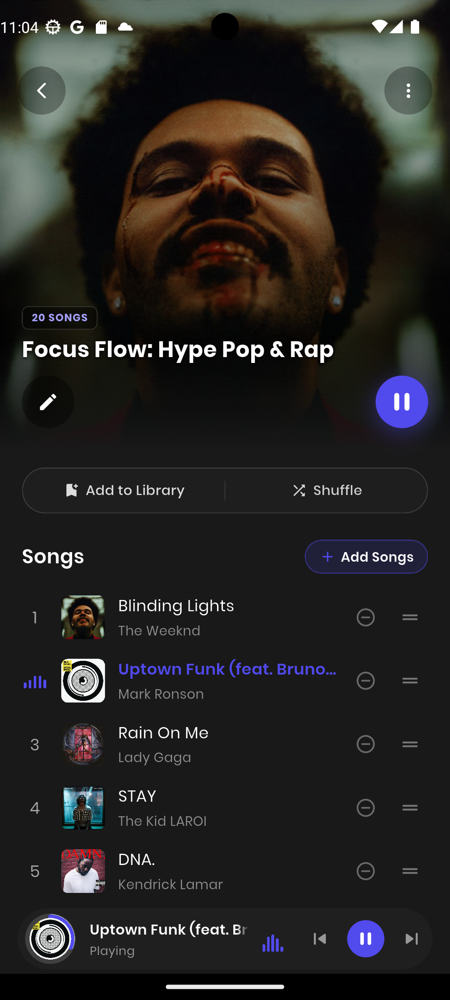
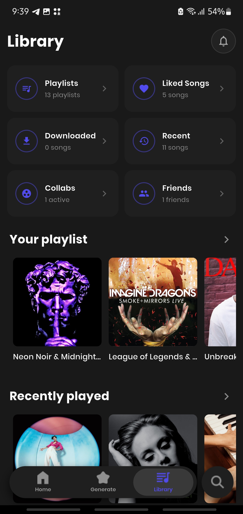
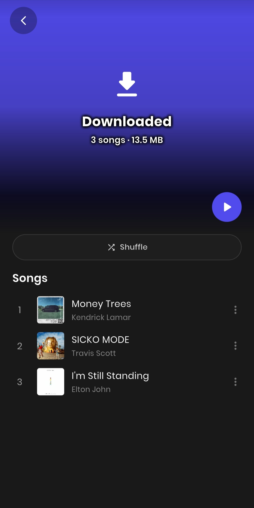

<p align="center">
  
</p>

# Melo — Full-Stack AI Music Streaming & Social Audio Platform

Melo is a full-stack music streaming platform engineered for mood-based curation, real-time social listening, and high-fidelity adaptive audio streaming. 

The system is architected as a high-performance distributed platform pairing a cross-platform **Flutter Mobile Client** with an enterprise **Spring Boot (Java 21) Microservice Backend** and **Supabase Realtime PostgreSQL**.

---

## System Architecture

```text
                        ┌─────────────────────────────────────────┐
                        │          Flutter Mobile Client          │
                        │    (iOS / Android Native Audio Engine)  │
                        └─────────────┬───────────────────────────┘
                                      │
                 ┌────────────────────┴────────────────────┐
                 │ REST / Audio Streaming                  │ Supabase Realtime / RLS
                 ▼                                         ▼
  ┌───────────────────────────────┐        ┌───────────────────────────────┐
  │     Spring Boot Microservice  │        │   Supabase Cloud Platform     │
  │          (Java 21)            │        │  (PostgreSQL, GoTrue, Sync)   │
  └──────────────┬────────────────┘        └───────────────────────────────┘
                 │
  ┌──────────────┼───────────────────────────────┬───────────────────────────────┐
  ▼              ▼                               ▼                               ▼
[ Deezer API ] [ Spotify Web API ]     [ Bakong KHQR Gateway ]       [ AI Engine ]
Audio Stream   Catalog Discovery        Merchant QR Payments         Groq Llama 3.3
& CDN Proxy    & Metadata Sync          & Signature Verification      Gemini & Tavily
```

---

## UI Showcase

| Onboarding & Setup | Home Feed | AI Vibe Generator |
|:---:|:---:|:---:|
|  |  |  |
| Onboarding & Authentication | Personalized Mixes & Discovery | Natural Language Playlist Generation |

| Now Playing & Lyrics | Playlist View | Library |
|:---:|:---:|:---:|
|  |  |  |
| Waveform Player & Synced Lyrics | Curated & Daily Playlists | Liked Songs & Followed Artists |

<p align="center">
  <b>Offline Mode & Local Storage</b><br/><br/>
  <br/>
  <i>Playback with zero data connection</i>
</p>

---

## Engineering Highlights & Capabilities

### 1. Spring Boot (Java 21) Microservice Backend (`SpringBackend/`)
- **Multi-Source Audio Proxy & Decoding:** Engineered a low-latency audio streaming proxy (`DeezerStreamController`, `DeezerStreamService`) with async request streaming (`spring.mvc.async.request-timeout=600000`) to pipe high-bitrate audio directly to clients without memory buffering bottlenecks.
- **AI Playlist Generation Engine:** Natural language prompt deconstruction across mood, energy, and acoustic profiles (`GenerateService`). Integrates Groq (Llama 3.3 70B), Google Gemini 2.5 Flash, and Tavily AI web search for real-time music discovery.
- **Bakong KHQR Payment Integration:** Native integration with the National Bank of Cambodia (NBC) Bakong KHQR Open API (`BakongPaymentService`). Supports dynamic merchant QR generation, transaction polling, and cryptographic payment verification.
- **API Defense & Performance:** Custom rate-limiting filter (`RateLimitFilter`) to prevent API abuse, in-memory stream caching, and multi-threaded background workers for catalog sync.
- **Microservice Containerization:** Fully containerized with a production-ready multi-stage `Dockerfile` and configured for seamless deployment on Docker, Railway, or AWS.

### 2. Flutter Mobile Application (`melo/`)
- **Adaptive Audio Pipeline:** Built using `just_audio` and `just_audio_background` with native notification controls, lock-screen playback, and dynamic seekable waveform visualizations.
- **Listen Together (Synchronized Playback):** Multi-user synchronized listening sessions powered by Supabase Realtime broadcast channels with latency compensation.
- **Encrypted Offline Storage:** AES-encrypted local storage for downloaded tracks and synchronized LRCLIB timestamped lyrics.
- **Adaptive Music Taste Engine:** Real-time client-side telemetry capturing completion rates, skips, and repeats to adapt user recommendations dynamically.

---

## Tech Stack

| Domain | Technologies |
| :--- | :--- |
| **Backend Framework** | Spring Boot 3.3, Java 21, Spring MVC, Spring Data, Maven |
| **Mobile Client** | Flutter 3.27, Dart 3.6, Provider, Flutter Secure Storage |
| **Audio Processing** | just_audio, just_audio_background, Custom Java Audio Stream Proxy |
| **Database & Auth** | Supabase (PostgreSQL with Row Level Security), H2 Database (Dev) |
| **AI Models & Search** | Groq (Llama 3.3 70B), Google Gemini 2.5 Flash, Tavily AI Search |
| **Payment Gateway** | Bakong KHQR Open API (National Bank of Cambodia) |
| **DevOps & Infra** | Docker, Railway, GitHub Actions, Vercel |

---

## Project Structure

```text
Melo/
├── melo/                         # Flutter Mobile Application
│   ├── android/                  # Android native project & manifest
│   ├── ios/                      # iOS native runner & permissions
│   ├── lib/
│   │   ├── config/               # API endpoints & theme configuration
│   │   ├── services/             # Audio playback, cache & Supabase sync
│   │   ├── view/                 # UI screens (Home, Player, Vibe, Library)
│   │   └── widgets/              # Waveforms, dialogs, and controls
│   └── supabase/                 # PostgreSQL schemas, functions & RLS policies
├── SpringBackend/                # Spring Boot Microservice Backend
│   ├── src/main/java/com/melo/
│   │   ├── config/               # Service beans (Bakong, Groq, Deezer, Spotify)
│   │   ├── controller/           # REST endpoints (Stream, Search, Payments, AI)
│   │   ├── dto/                  # Request / Response transfer objects
│   │   ├── service/              # Core business logic & stream decoders
│   │   └── security/             # Rate-limiting filter and CORS policy
│   ├── src/main/resources/       # application.properties and static seeds
│   ├── Dockerfile                # Production container deployment definition
│   └── pom.xml                   # Maven project descriptor
├── screenshots/                  # Mobile showcase screenshots
└── README.md                     # Monorepo technical documentation
```

---

## Getting Started

### Prerequisites

- **Java JDK**: 21 or higher
- **Maven**: 3.8+ (or use included `./mvnw`)
- **Flutter SDK**: 3.27 or higher
- **Supabase Account**: PostgreSQL instance

---

### Step 1: Start the Spring Boot Backend

1. Navigate to the backend directory:
   ```bash
   cd SpringBackend
   ```

2. Configure environment credentials:
   ```bash
   cp .env.example .env
   ```
   *Fill in your Groq API key, Spotify credentials, and optional Bakong payment token.*

3. Run the Spring Boot application:
   ```bash
   # On Windows (PowerShell):
   .\mvnw.cmd spring-boot:run

   # On Linux/macOS:
   ./mvnw spring-boot:run
   ```
   The backend service will boot up at `http://localhost:8080`.

---

### Step 2: Run the Mobile Application

1. Navigate to the mobile app directory:
   ```bash
   cd melo
   ```

2. Configure environment credentials:
   ```bash
   cp .env.example .env
   ```
   *Add your `SUPABASE_URL`, `SUPABASE_ANON_KEY`, and set `BACKEND_URL=http://10.0.2.2:8080` (for Android Emulator) or your local machine IP.*

3. Install dependencies:
   ```bash
   flutter pub get
   ```

4. Launch the application:
   ```bash
   flutter run
   ```

---

## Security & Secrets Management

- **Zero Hardcoded Credentials:** All API keys, tokens, and database passwords in `application.properties` and the Flutter client dynamically resolve via environment variables.
- **Protected Version Control:** All `.env` files, `.log` files, and `target/` binaries are strictly excluded by `.gitignore`.
- **Database Row Level Security:** Every table in the Supabase PostgreSQL database enforces user-scoped RLS policies.

---

## Author

**Sok Virak** — [@VirakSok18](https://github.com/VirakSok18)
